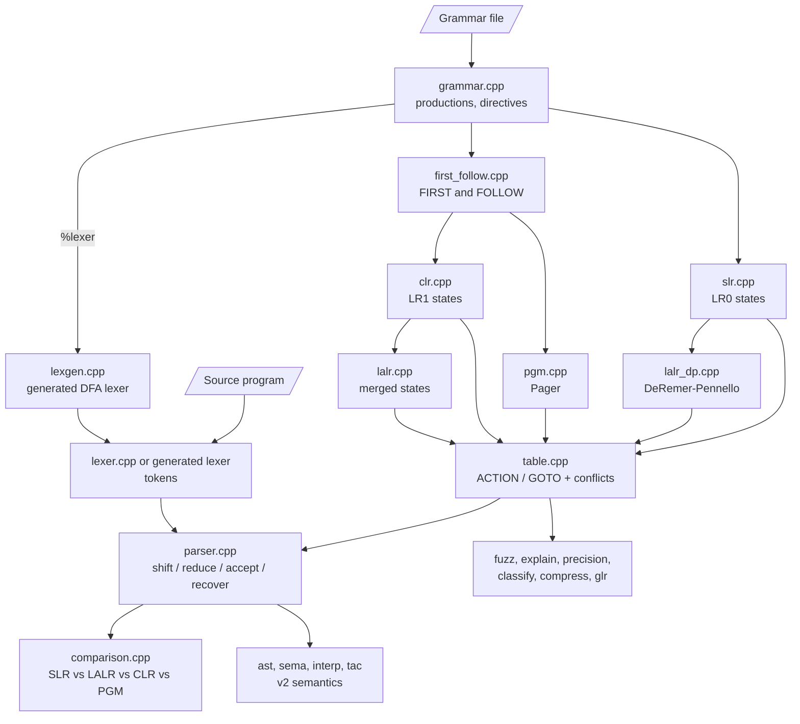

# ParserX — SLR, LALR, CLR and PGM Parsers Compared

SLR, LALR (two constructions), canonical LR(1) and Pager's minimal LR(1)
parsers built from scratch in C++17 from a grammar file loaded at run time,
plus the tools to measure *how much* they differ: differential fuzzing,
conflict explanations with verified witnesses, a precision index, a grammar
classifier, table compression, GLR, and a small C-like language with
semantic analysis, an interpreter and three-address code.

No parser or lexer generators and no libraries beyond the C++ standard
library are used: every automaton and table is built by this code.

Measured results are in [docs/RESULTS.md](docs/RESULTS.md).

## Features

| Area | What it does |
|------|--------------|
| Tables | SLR (LR(0) + FOLLOW), CLR (LR(1)), LALR by merging CLR states **and** by DeRemer–Pennello relations, PGM (Pager's weak compatibility); one table-driven driver runs them all |
| Grammar files | `%left %right %nonassoc %prec`, `%name`, `%sync`, `%recover`, `%lexer`, `%semantics`; warnings for unreachable / unproductive symbols and duplicate rules |
| Lexers | the built-in v1 lexer, or a lexer generated from a `.lex` spec: regex → Thompson NFA → subset DFA → minimised DFA |
| Comparison | states, table entries, conflicts, parse steps, error position, reductions before the error, expected tokens, context messages |
| Experiments | `--fuzz` differential fuzzing, `--explain` provenance and witnesses, `--precision`, `--classify`, `--random-grammars`, `--bench` |
| Robustness | `--recover` (panic mode or `error` productions), `--compressed` tables, `--glr` parse counting |
| Language v2 | `grammar/language_v2.txt`: declarations, pointers, arrays, `if/else`, `while`, `for`, `print`, `&& \|\| !`; semantic checks, `--run`, `--tac` |
| Exports | Graphviz DOT, a self-contained HTML trace, CSV tables |

## Source Files

| File | What it does |
|------|--------------|
| `parserx.cpp` | Main program: options and the steps below in order |
| `src/lexer.cpp` | Built-in v1 lexer with line and column numbers |
| `src/regex.cpp`, `src/lexgen.cpp` | Regex parser, Thompson NFA, subset construction, DFA minimisation; the generated lexer |
| `src/grammar.cpp` | Grammar loader, directives, augmentation, symbol ids, warnings |
| `src/first_follow.cpp` | Nullable, FIRST, FOLLOW (with the reason each terminal was added) |
| `src/slr.cpp`, `src/clr.cpp` | LR(0) and LR(1) item sets |
| `src/lalr.cpp`, `src/lalr_dp.cpp` | LALR by merging CLR states; LALR by DeRemer–Pennello (digraph, reads, includes, lookback) and the equivalence check |
| `src/pgm.cpp` | Pager's practical general method |
| `src/table.cpp` | ACTION/GOTO tables, conflicts and their resolution (precedence or default) |
| `src/parser.cpp` | The table-driven parser: traces, errors, recovery, parse tree |
| `src/compress.cpp` | Default reductions, row sharing, comb-vector packing |
| `src/comparison.cpp`, `src/context.cpp` | Comparison of the four parsers; context-aware error messages |
| `src/fuzz.cpp`, `src/explain.cpp`, `src/precision.cpp`, `src/classify.cpp`, `src/randgram.cpp` | The experiments |
| `src/ast.cpp`, `src/sema.cpp`, `src/interp.cpp`, `src/tac.cpp` | v2 AST, semantic analysis, interpreter, three-address code |
| `src/glr.cpp`, `src/visual.cpp`, `src/bench.cpp` | GLR, exports, benchmarks |
| `src/main.cpp` | The original small fixed demo (built as `parser`) |

## Flow



## Build and Test

1. Install `g++` with C++17 (on Windows: MSYS2 UCRT64; its make is `mingw32-make`).
2. Build: `make` (or `mingw32-make`). Without make (bash; `src/main.cpp` is the
   separate demo and has its own `main`, so it is left out):
   ```
   g++ -std=c++17 -O2 -Isrc parserx.cpp $(ls src/*.cpp | grep -v main.cpp) -o parserx -static
   ```
3. Tests:
   - `make test` — unit tests (`tests/unit/unit_tests.cpp`) and every case in `tests/cases`
   - `make unit` — unit tests only
   - `make check-all` — clean `-Werror` build, unit tests, case tests, `--verify` on every
     grammar, a fixed-seed `--fuzz 2000` run on v1 and v2, witnesses and zoo classes
   - `make sanitize` — AddressSanitizer/UBSan build (Linux only; MinGW does not support ASan)

## Running

```
parserx --code "y = a + b * c ;"
parserx --input program.txt
parserx                                  (type the program, then a line containing only END)
parserx --grammar grammar/language_v2.txt --input prog.src --run
```

### Options

| Option | Meaning | Example |
|---|---|---|
| `--grammar FILE` | grammar file (default `grammar/language.txt`) | `--grammar grammar/language_v2.txt` |
| `--input FILE`, `--code TEXT` | the program (a bare file name also works) | `--code "x = 1 ;"` |
| `--parser slr\|lalr\|clr\|pgm\|all` | which traces, states and tables are printed; the comparison always covers all four | `--parser pgm` |
| `--trace brief\|full\|none` | trace detail; brief shows the first and last 12 steps | `--trace full` |
| `--tokens` | print the token table even for more than 200 tokens | |
| `--states`, `--tables` | print item sets / ACTION and GOTO tables | `--parser lalr --tables` |
| `--dump-dfa` | print the generated lexer's minimised DFA | `--grammar grammar/language_v2.txt --dump-dfa` |
| `--lalr-method merge\|dp` | LALR table used by the parser (default `merge`) | `--lalr-method dp` |
| `--verify-lalr` | check that both LALR constructions give the same table up to renumbering | |
| `--verify-pgm` | check `LALR ≤ PGM ≤ CLR` states and no PGM conflict when CLR has none | |
| `--verify-compress` | check every compressed lookup against the raw table | |
| `--verify` | all three checks | `--grammar grammar/zoo/json.txt --verify` |
| `--compressed` | parse from the compressed tables | `--compressed` |
| `--recover`, `--max-errors N` | report many errors (panic mode or `error` productions), at most N (default 50) | `--recover --max-errors 10` |
| `--explain` | FOLLOW / merge provenance and verified shortest witnesses for every conflict | `--grammar grammar/slr_vs_lalr.txt --explain` |
| `--precision` | spurious lookaheads of SLR / LALR / PGM against CLR | |
| `--classify` | LR(0), SLR(1), LALR(1), LR(1) or not LR(1), from raw conflicts | `--grammar grammar/zoo/palindromes.txt --classify` |
| `--glr` | GLR parse on the unresolved LALR table; counts distinct parses | `--input tests/cases/07_dangling_else.src --glr` |
| `--fuzz N`, `--seed S`, `--max-depth D`, `--csv FILE` | differential fuzzing with N sentences and 4 mutants each (seed 20261015, depth 12) | `--grammar grammar/language_v2.txt --fuzz 2000 --csv fuzz.csv` |
| `--random-grammars N` | random reduced grammars, classified and summarised (uses `--seed`, `--csv`) | `--random-grammars 1000` |
| `--run`, `--tac`, `--max-steps N` | for `%semantics v2` grammars: interpret, print three-address code, step limit (default 10⁶) | `--run --tac` |
| `--dot automaton\|lalr-merge FILE` | Graphviz DOT (with `--parser all` one file per parser: `FILE_slr.dot` …) | `--dot lalr-merge merge.dot` |
| `--html-trace FILE` | one self-contained HTML page stepping through the traces side by side | `--html-trace trace.html` |
| `--csv-tables DIR` | ACTION and GOTO tables as CSV | `--csv-tables tables` |
| `--bench`, `--repeat R` | build and parse timings (median and minimum of R runs) and a scaling series | `--bench --repeat 10` |

Without `--input`/`--code`, the program is read from the keyboard until a
line `END`. `--fuzz`, `--classify`, `--verify*` and `--random-grammars` need
no program.

### Exit codes

| Code | Meaning |
|---|---|
| 0 | every parser accepted (and semantic analysis passed, if any) |
| 1 | at least one parser rejected the program |
| 2 | grammar error or lexer-spec error |
| 3 | lexical error |
| 4 | bad option or unreadable input file |
| 5 | semantic error or run-time error (`%semantics v2`) |
| 6 | a check failed (`--verify*`, fuzzing invariants) |

## Grammar Files

```
# comment
%left  + -              lowest precedence first; each later line binds tighter
%left  * /
%right UMINUS           a pseudo-terminal used only with %prec
%nonassoc relop         a relop b relop c becomes a syntax error
%name  E "expression"   name used in error messages
%sync  ; }              tokens panic-mode recovery skips to (default ; })
%recover S              non-terminal recovery returns to
%lexer language_v2.lex  token spec for the generated lexer (relative to the grammar)
%semantics v2           enable the v2 AST, checks, --run and --tac

E -> E + E | E * E | ( E ) | id
E -> - E %prec UMINUS
A -> eps                (also epsilon, empty or ε)
```

- `->` or `→`; `|` separates alternatives (`||` is an ordinary terminal).
- A symbol that appears on a left side is a non-terminal; all others are terminals.
- The first left side is the start symbol; `P' -> P` is added as production 0.
- A production's precedence is that of its last terminal, unless `%prec` gives one.
  Shift/reduce conflicts with precedence on both sides are resolved by it
  (higher binds tighter; equal: `%left` reduces, `%right` shifts, `%nonassoc`
  becomes an error); others are resolved by shift, reduce/reduce by the
  lower-numbered production. All of them are reported.
- Errors carry line numbers: missing `->`, unknown directive, `%prec` not at
  the end or with an undeclared symbol, a terminal declared twice, `%name` or
  `%recover` for a non-terminal that does not exist. Duplicate productions are
  reported and ignored.

## Lexer Specs (`.lex`)

```
%skip     [ \t\r\n]+               text to discard
%skip     //[^\n]*
real      [0-9]+\.[0-9]+          NAME REGEX: tokens of type NAME
num       [0-9]+
%keywords if else while           identifiers equal to these become their own token
id        [A-Za-z_][A-Za-z0-9_]*
%literals && || += = ; ( )        literal tokens, type = the text itself
```

Regex syntax: concatenation, `|`, `*`, `+`, `?`, `( )`, `[a-z]`, `[^...]`, `.`,
`\t \n \r \s \d \w` and `\c` for any other character. Longest match wins, then
the earlier rule. Lines and columns are counted like the v1 lexer (tab and
`\r` are one column). `3.` and `.5` are not numbers in v2: the dot is an
unknown character.

## Machine-Readable Lines

At the end of the output (tests grep these):

```
TABLE <SLR|LALR|CLR|PGM> states=N action=N goto=N sr=N rr=N [sr_prec=N nonassoc=N]
CONFLICT <name> <shift/reduce|reduce/reduce> on '<sym>' state=N -> <resolution>
RESULT <name> ACCEPTED steps=N
RESULT <name> REJECTED token=T line=L col=C step=S reduces=R expected=<tokens>
TREE <name>: <bracketed tree>
RECOVERY <name> errors=N skipped=K first=L:C [stopped="reason"]
COMPRESS <name> raw_bytes=N packed_bytes=N ratio=X
RESULT LEXICAL-ERROR symbol='c' line=L col=C
RESULT GRAMMAR-ERROR <message>
RESULT LEXER-SPEC-ERROR <message>
RESULT SEMANTIC-OK warnings=N declarations=N  |  RESULT SEMANTIC-ERROR count=N warnings=N
RESULT RUNTIME-ERROR line=L col=C message="..."  |  RUN ok steps=N outputs=N
TAC lines=N
VERIFY LALR dp==merge OK (...)   VERIFY PGM ...   VERIFY COMPRESS <name> OK (...)
EXPLAIN <name> state=N symbol='a' witness="..." verified=yes|no cause="..."
PRECISION SLR=N LALR=N PGM=N CLR=0 spurious_reduce_slr_vs_lalr=N inflation_slr=X ...
CLASS <class>   and   CLASS raw lr0=N slr=N lalr=N clr=N pgm=N
GLR accepted parses=N gss_nodes=N sppf_nodes=N  |  GLR rejected token=I
FUZZ <name> inputs=N accepted=A mean_delay=X max_delay=Y mean_expected=Z median_delay=M valid_rejected=V
FUZZ AGREEMENT inputs=N agree=A disagreements=D explained=E lalr_merged=K/L
FUZZ INVARIANTS OK | FAILED (n)
RANDOM grammars=N seed=S LR(0)=.. SLR(1)=.. LALR(1)=.. LR(1)=.. not-LR(1)=..
BENCH build|parse|scale ...
```

Decimals in these lines always have three digits.
